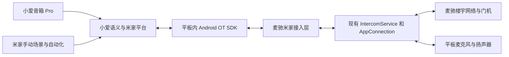

# 麦驰直连 App 接入米家与小爱开发方案

日期：2026-11-13。状态：可行性评估与开发建议，尚未开始接入实现。首选 Android OT SDK，实际开发以取得 SDK、确认普通 APK 的运行条件为前提。

## 结论与范围

目标是让用户对小爱音箱说话，由现有麦驰直连 App 执行呼梯、接听门禁、开锁和挂断；争取让音箱承担双向对讲，若不能则由平板负责声音。用户已确认具备米家 IoT 企业开发者及澎湃 OS 开发者权限，现有设备为小爱音箱 Pro、小米中枢网关、绿联 DX4600 和运行麦驰 App 的平板。

**首选让 Android App 通过官方 Android OT SDK 作为米家设备接入。** 米家负责设备绑定、指令和家庭联动，App 继续独占麦驰楼宇协议、来电会话、门机连接与音频。第一期以“小爱控制、平板通话”为交付目标，音箱本身承载访客双向声音单独评估。

该架构具有实现基础，但还不能承诺普通 APK 可直接安装 SDK 后完成绑定。官方最新接入总览明确列出了 Android OT SDK；本次在用户完成登录、并确认企业产品管理入口可用后，Android 和 Linux SDK 的正文仍显示“暂不支持该文档开放，敬请谅解”。这证明当前会话无法读取这些文档，不能据此推断需要 root、系统签名，或 SDK 已被取消。[接入方式总览](https://iot.mi.com/v2/new/doc/introduction/preparation/access_mode)、[Android OT SDK 开发](https://iot.mi.com/v2/new/doc/embedded-dev/android-ot/quickstart)

| 需求 | 评估 | 实现边界 |
| --- | --- | --- |
| 对小爱说“帮我叫电梯” | 有条件可行，优先验证 | SDK 收到指令后调用现有呼梯入口；这句口语能否直接命中，需要单独验证小爱路由或场景别名 |
| 来电时说“接听” | 有条件可行 | 指令控制当前来电，平板负责播放和录音；先验证“接听门禁”等明确说法，再验证简称 |
| 说“开锁” | 有条件可行 | 仅作用于本次有效来电，需能拒绝旧指令、重放及断线后补发；发送成功不能冒充物理门锁已打开 |
| 说“挂断” | 有条件可行 | 调用本次来电的挂断入口；需要避免小爱将简称理解成其他电话或会话 |
| 单元门来电联动音箱提示 | 有条件可行 | App 上报来电状态或事件，米家自动化调用音箱实际提供的提示能力，按型号验证 |
| 直接用小爱音箱 Pro 与访客双向对讲 | 不能作为当前交付承诺 | 尚未获得该型号面向第三方 App 的实时双向音频接口；第一期使用平板音频 |

这里的“有条件可行”表示控制架构成立，并非已通过 SDK、实际音箱和门机的端到端验收。

## 官方资料确定的能力与限制

### Android OT SDK 是首选接入方向

2026-05-06 更新的官方接入方式总览，在 Linux 或 Android 产品下分别列出了 Linux OT SDK 和 Android OT SDK。直连方式支持米家控制、小爱语控和设备互联。因此，应先评估设备端 Android OT SDK，而不是把“个人开发者仅支持模组”的限制套用到本项目的企业账号上。[接入方式总览](https://iot.mi.com/v2/new/doc/introduction/preparation/access_mode)

需要区分三个方向：

- **Android OT SDK**：让运行 App 的终端接入米家，接收设备指令并上报状态，本方案首选。
- **小爱 AIVS 语音 SDK**：让开发者自己的设备或应用具备语音交互能力，不能据此获得家中现有音箱的麦克风数据。
- **独立 App 控制接入**：让自有 App 控制已经接入米家的自有产品，不能替代设备端入网和绑定。

依据：[小爱 Android SDK](https://developers.xiaoai.mi.com/documents/Home?type=%2Fapi%2Fdoc%2Frender_markdown%2FVoiceserviceAccess%2FDevice%2Fdevelop%2FSDKDocument%2FAndroidInstruction)、[控制应用接入](https://iot.mi.com/new/doc/accesses/direct-access/other-platform-access/application-access)。

### 定义动作不等于小爱自动懂得该说法

2026-04-07 更新的“适配超级小爱”说明，直接语控面向平台已支持的标准功能，不支持产品任意自定义功能；未支持的语控需求可另行申请。当前公开清单没有给出本项目所需的呼梯、接听门禁、开锁和挂断门禁四项标准语控。[适配超级小爱](https://iot.mi.com/v2/new/doc/resources-and-services/design/feature-define/language-control)

本方案将设备控制与语音说法分开验收：先实现米家可以执行的动作，再配置手动场景作为语音入口，例如“麦驰呼梯”“接听门禁”“单元门开锁”“结束门禁通话”。以音箱实际识别为准，将“帮我叫电梯”等日常说法映射到这些入口；可用时再配置该型号支持的小爱训练或申请标准语控。米家手动场景可由小爱执行有官方使用示例，但不能因此保证任意场景名、简称都能识别。[米家场景使用示例](https://home.mi.com/webapp/content/article.html?uuid=651994586125971456)

### 音箱通话与控制指令是两条链路

音箱自定义技能的公开协议支持识别结果、意图、请求编号、时间戳、语音回复和音频播放。`open_mic` 用于后续语音交互，不能当成对讲所需的连续实时麦克风流接口。[音箱自定义技能](https://developers.xiaoai.mi.com/documents/Home?type=%2Fapi%2Fdoc%2Frender_markdown%2FSkillAccess%2Fskill%2FCustomSkillsMain)

小爱音箱 Pro 的产品资料列出蓝牙播放及 AUX 输入，这不能证明 App 能使用音箱麦克风；部分触屏音箱与指定门铃支持对讲，也不能外推到本项目的音箱型号和自建接入设备。[小爱音箱 Pro](https://www.mi.com/aispeaker-pro?product_id=1193600021)、[触屏音箱与门铃联动示例](https://www.mi.com/aispeaker-pro8?product_id=1194900016)

用户提供的澎湃 OS 文档中，VoIP Service Kit 主要提供系统通话管理和来电交互；小米妙播主要提供播放音频的流转，两者都未建立本项目所需的“现有音箱麦克风→麦驰门机”通路。Skill 和 Agent 发布指南又明确限定在 Miclaw 分发，不能直接视为小爱音箱技能。[VoIP 服务](https://dev.mi.com/xiaomihyperos/documentation/detail?pId=2246)、[妙播音频](https://dev.mi.com/xiaomihyperos/documentation/detail?pId=1912)、[Skill 发布](https://dev.mi.com/xiaomihyperos/documentation/detail?pId=2307)、[Agent 发布](https://dev.mi.com/xiaomihyperos/documentation/detail?pId=2305)

## 现有 App 的实现基础

以本次读取的工作区为依据，当前已有以下入口：

| 位置 | 可以复用的职责 |
| --- | --- |
| `AppConnection.callElevator()` | 呼梯，已有发现、等待回应和超时状态 |
| `IntercomService.answer(CallKey)` | 接听及麦克风准备，进一步调用 `AppConnection.answerCall` |
| `AppConnection.unlockCall(...)` | 按次来电校验、一次发送、排队过期拒绝、冷却和结果反馈 |
| `AppConnection.hangUpCall(CallKey)` | 结束指定来电并停止音频 |
| `IntercomState`、`CallKey` | 当前连接、通话、声音状态及进程内来电标识 |
| `EthernetTransport` | 将楼宇 UDP Socket 绑定到对应以太网网络 |

源文件：[AppConnection](../../../app/src/main/kotlin/com/maichimod/prototype/AppConnection.kt)、[IntercomService](../../../app/src/main/kotlin/com/maichimod/prototype/IntercomService.kt)、[EthernetTransport](../../../app/src/main/kotlin/com/maichimod/prototype/transport/EthernetTransport.kt)。

当前代码已包含持续接待服务和独立来电页。目标 MatePad 已验证真实米家前台及息屏下的样本来电自动展示、部分闲置返回、真实重启自动启动，以及单元门和地库 2 的真实监控；这些结果不代表真实门机来电、双向声音、物理门锁或长期稳定性通过。门禁地址重启后丢失仍待解决，米家接入不得绕过这项现有接待前提。[专用终端验收记录](../../runbooks/dedicated-intercom-acceptance.md)、[实际门禁网络记录](../../runbooks/tablet-live-validation-2026-11-14.md)

新增接入层只负责外部指令的校验、转换、反馈，以及已有状态的上报。它复用现有服务和会话，不另建门机 Socket、音频系统或通话状态机。

## 推荐架构

这张图表达目标架构。普通 APK 能否使用 SDK、绑定流程和具体 API 名称，必须在取得 SDK 后确认；不能凭图中的模块名称自行实现小米的私有协议。

### 平板与账号绑定

在企业组下确认适用品类，建立测试产品和功能定义，按官方方式取得产品标识及设备凭据。使用开发者测试账号完成配网或绑定，再验证米家读取状态及执行无副作用动作。平台是否允许该终端形态及所需品类，以实际配置与平台答复为准。

SDK 凭据按官方方法独立配置到终端，不写进可分发 APK 或仓库；稳定设备身份和设备解绑、重装后的恢复规则一并验证。首个版本面向本户，公开发布与多住户部署另行规划。

### 内部动作模型

以下是 App 内部建议名称，**不是已经获准的小米标准服务，也不是已确认的 SIID、AIID 或 PIID**。

| 动作 | 前置条件 | 调用与反馈 |
| --- | --- | --- |
| `call_elevator` | 接待启用，对讲网络正常，无正在等待的呼梯 | 调用呼梯入口，区分已提交、门机回应与超时 |
| `answer_call` | 当前来电仍在响铃，标识匹配 | 经 `IntercomService.answer` 接听，反馈麦克风和播放状态 |
| `unlock_current_call` | 当前来电有效，标识及指令时效有效 | 复用 `unlockCall`，区分拒绝、已发送与结果未确认 |
| `hang_up_call` | 当前来电有效，标识匹配 | 挂断本次来电，停止录放音 |

建议以方法表达一次性动作。状态及事件包括在线状态、接待启用、来电状态、呼梯状态、音频健康和最近命令结果；米家可选提供来电、接听、结束和失败的联动入口，具体以平台允许的功能定义与自动化配置为准。[MIoT Spec](https://iot.mi.com/v2/new/doc/introduction/knowledge/spec)、[自动化配置](https://iot.mi.com/v2/new/doc/configuration/advance-configure/automation)

### 按次来电执行与结果反馈

- 每条外部控制请求必须能关联到指定终端；接听、开锁、挂断再关联到本次 `CallKey`。不允许把一条旧请求在执行时重新解释为“下一通当前来电”。
- 语音控制仅开放给已完成绑定的本户接入通路，平台支持时进一步限定本户指定音箱。账号绑定和请求签名不识别实际说话者，也不把声纹当作已验证的开锁身份。由于第一期由平板播放访客声音，需验证这种声音能否唤醒附近音箱并触发开锁；这是待验证的声音路径风险，不是已经发现的故障。若会触发且无法通过受支持的交互可靠隔离，该环境下不启用全自动语音开锁，保留现有平板手动开锁，其余语控继续提供。
- 取得 SDK 后检查回调是否包含可用的请求标识、原始时间和重试语义。仅在接收时生成新编号或新时间，不能解决上游延迟和重放问题。没有足够时效依据的静态开关场景，不能直接作为语音开锁交付通路。
- 对已识别的重复请求去重，断线和重启后不补做呼梯或开锁；不确定是否发送完成时返回未确认，不自动重发。保留现有开锁排队超过 1 秒拒绝、1.5 秒冷却和开锁后自动挂断设置。
- 接入层的接收成功、App 执行结果、门机回应和物理结果分别表达。小爱若只回答“场景已执行”，不把它解释为门锁已打开或电梯已到达；具备结果回复通道时，按真实结果说“已发送开锁请求”“门机已响应呼梯”等。

如 Android OT 的场景指令不足以携带可靠的按次上下文，需评估平台支持的参数方法或音箱自定义技能。自定义技能协议已有请求编号、时间戳及签名校验规范，可以在已校验的请求入口结合来电快照建立控制请求；它仍需完成实际账号权限和接口联调。

### 网络和后台运行

平板同时连接楼宇以太网和家庭网络时，麦驰 UDP 继续绑定楼宇网口，米家 SDK 通过有互联网能力的家庭网络通信。验证 SDK 是否会修改整个进程的网络绑定；禁止为了米家连云而破坏现有门机收发，也不把楼宇网络通过 NAS 或家庭网关转发出去。

小米中枢网关可以参与实际支持的自动化，但它不等于任意 LAN HTTP 指令入口，也不能预先保证该产品能离线联动。首期联网语控与断公网行为分别测试。

语音接听还要处理 Android 的麦克风使用限制。已有录音权限、接待常驻服务，并不自动证明后台远程触发就能取得麦克风。优先在有效来电页已显示时完成接听和录音启动；权限不足或系统拒绝时明确反馈，不能宣称双向通话已建立。[Android 麦克风前台服务限制](https://developer.android.com/develop/background-work/services/fgs/restrictions-bg-start)

## 备选方案与切换条件

| 方案 | 采用条件 | 代价和差别 |
| --- | --- | --- |
| A Android OT SDK 直连，首选 | SDK 可获得，允许目标平板上的 APK 运行，能绑定并接收功能指令 | App 内完成接入，NAS 不是必需组件；需要解决 App 生命周期和双网络 |
| B DX4600 运行 Linux OT 接入服务 | Android 方案要求无法满足的系统集成，而平台允许 Linux SDK 用于该网关形态，并提供 NAS 可用的构建 | 米家设备由 NAS 代表，平板通过已配对的家庭网络连接收发控制与状态；楼宇协议和声音仍在 App |
| C 小爱音箱自定义技能 | IoT SDK 暂不可得，而账号可创建并调试音箱技能 | 自建 HTTPS 接口接收意图，再通过平板主动建立的加密长连接转发；不自动获得米家设备页面和来电自动化 |

当前 Android 和 Linux SDK 正文均未能读取，所以 B 也只是候选，不能将 Linux SDK 视为现成的任意 NAS 容器软件。

C 能满足“音箱发指令、App 执行”的主要交互，但第三方技能通常要求包含调用名，例如“让麦驰管家帮我叫电梯”，不能保证无调用名的“接听”自动路由到本技能。小爱云端也不能直接请求家庭私网地址：若采用该方案，需要可公开访问的 HTTPS 接口或小型云转发服务，NAS 可承载满足网络条件的服务，不能省略公网到私网的可达性设计。[技能类型与唤起](https://developers.xiaoai.mi.com/documents/Home?type=%2Fapi%2Fdoc%2Frender_markdown%2FSkillAccess%2Fdes)、[音箱技能示例](https://developers.xiaoai.mi.com/documents/Home?type=%2Fapi%2Fdoc%2Frender_markdown%2FSkillAccess%2FSkillExample%2FSoundboxHelloWorld)

另外两条路线不优先：个人开发者的标准模组加 MCU 方案需要额外硬件且模板受限；云对云 2.0 支持米家展示及控制，但当前总览标明受邀准入，且不提供表中设备互联互通能力。不能用开发者认证成功代替这些独立权限。[个人开发者范围](https://iot.mi.com/v2/new/doc/resources-and-services/personal-developer/overview)、[接入方式总览](https://iot.mi.com/v2/new/doc/introduction/preparation/access_mode)

不同时开发 A、B、C。先做 A 的资源与运行条件验证，确有障碍再选择一条备选。

## 分阶段开发与验收

以下为单名熟悉现有 App 的开发者的工作量估算，不包含 SDK 资源开通、平台评审等待或现场排期。

| 阶段 | 主要工作 | 通过标准 | 估算 |
| --- | --- | --- | --- |
| P0 获取 SDK 并确认路线 | 取得 Android OT 正文、SDK 和示例；确认普通 APK、系统权限、支持平台、设备凭据、配网、指令语义和语音开锁授权边界 | 书面条件明确；目标平板能加载官方示例或有充分依据选择备选 | 0.5～1 天，另加平台等待 |
| P1 最小接入验证 | 测试产品绑定、读取状态、执行无副作用测试动作、断线重连、以太网加 Wi-Fi 共存 | 米家操作能到达目标平板；测试不操作真实门锁或电梯 | 1～2 天 |
| P2 App 控制和状态对接 | 接入层复用四个控制入口，完成按次绑定、去重、过期拒绝及结果上报 | 样本与隔离传输验证通过，旧通话指令不能影响新通话 | 2～3 天 |
| P3 小爱与来电联动 | 在实际音箱配置并验证场景语控、日常说法、来电提示、结束后的状态恢复 | 四项明确说法逐项能用；简称和口语化表达分别记录识别结果 | 1～2 天 |
| P4 真实设备验收 | 验证后台、锁屏、真实声音、门锁、呼梯、网络切换和恢复 | 现场人员确认实际效果；异常反馈和失败后恢复符合预期 | 2～3 天 |
| P5 稳定观察 | 先完成 24 小时，再累计完成 72 小时观察 | 长时间切到米家、息屏、网络变化后仍可接待；没有延迟补执行 | 约 3 天自然时间 |

在 Android SDK 可获得、允许普通 App 运行、现有接待能力已经稳定的前提下，首期约 **7～11 个开发工作日，加稳定观察时间**。SDK 需要额外平台适配、切换 NAS 或自定义技能时重新估算。音箱原生双向对讲不包含在这一估算内。

### 核心验收场景

1. 小爱发出呼梯命令后，App 实际收到一次有效请求；正常回应与超时分别反馈，现场另行确认到梯。
2. 响铃时用小爱接听，访客声音从平板播放，平板麦克风能让访客听清；无麦克风权限、失焦和录音失败有明确结果。
3. 小爱开锁只针对当前有效来电，发送前后来电结束、快速连续来电、重复指令、断网恢复、进程重启都不能导致旧请求开锁。
4. 先在隔离传输下，由平板播放含唤醒词及开锁口令的访客声音或录音，检查附近音箱是否生成有效开锁请求；结合真实摆放和音量复测。无法可靠隔离时，全自动语音开锁不通过，不以签名正确或当前有来电代替发令者授权判断。
5. 小爱挂断后停止录放音，结束同一来电；已经结束的请求不影响下一通。
6. 米家在前台、系统锁屏、平板暗屏和 App 无界面绑定时分别验证。音箱正在播音乐时也验证语控及提示行为。
7. 来电事件仅触发该次预期联动；接听或结束后不继续重复播报。指定铃声和播报顺序按音箱实际能力记录。
8. 单独断开家庭互联网、家庭 Wi-Fi、楼宇网线和 NAS（仅采用 B/C 时）验证。没有通过的离线语控或中枢本地执行能力不对外宣称。
9. 两个账号或错误终端的指令不能控制本户 App。解绑后凭据失效，重新绑定不恢复旧待执行动作。

自动化与模拟器测试使用假传输和样本；实际呼梯、开锁由现场人员有意识地参与并确认。

## 音箱直接对讲的后续验证

先向平台确认小爱音箱 Pro 是否向本企业开放与自建门禁终端匹配的实时双向音频或门铃对讲接入，要求明确具体型号、SDK、品类、权限与测试入口。存在对应官方能力后，再评估音频编解码、上下行通道、时延、回声处理、音箱唤醒和通话中的控制指令。

如果只有音频播放或 TTS 能力，保留“小爱控制、平板通话”。不把一次录音文件、音频投送、蓝牙播放或多轮语音识别拼接成已支持的实时对讲。

## 可直接向平台核实的问题

以下内容是可复制的问题清单，未代用户发送：

> 企业账号已通过认证，希望将现有安卓平板上的麦驰门禁 App 通过 Android OT SDK 接入米家，用于本户呼梯、来电状态上报、接听、开锁和挂断。企业产品管理入口可用，但 Android OT SDK 和 Linux OT SDK 文档仍显示“暂不支持该文档开放”。
>
> 请确认并提供：Android OT SDK 文档、SDK 和示例的开通方式；是否支持普通安装的第三方 APK，是否要求系统签名、系统应用、定制固件或特定硬件；支持的 Android 版本与 ABI、无屏或有屏配网绑定方式、设备身份与凭据获取方法；该门禁终端适用品类及允许的测试范围；自定义动作能否用于手动场景和自动化，以及语音呼梯、接听、开锁、挂断是否需要单独申请；指令是否有请求编号、可信时间、去重与离线重试约定；小爱音箱 Pro 是否存在本用途可使用的实时双向对讲接口。
>
> 若普通 APK 不受支持，请确认 Linux OT SDK 是否允许在自用 NAS 网关运行、支持哪些系统和 CPU 架构，以及是否有无需新增硬件的官方替代方式。

## 本轮交付与下一步

本轮交付为资料评估和上述开发方案，未创建小米产品、未提交平台申请、未安装 SDK，也未触发真实门锁或电梯。

下一步从 P0 开始：取得 Android OT SDK 资料，确认普通 APK 的条件，再在平板做“米家动作→App 日志”的最小无副作用验证。这个验证通过后，才将四个实际动作接入；其中接听、开锁和挂断必须同时通过按次来电与时效检查。

## SDK 下载和企业账号前置条件核查

2026-11-13 首次核对企业后台；2026-11-14 在用户同意 GitLab 登录后，确认登录成功并复核项目可见性和资源申请前置条件。当前结果如下：

| 项目 | 当前后台显示 | 后续操作 |
| --- | --- | --- |
| 企业基础资料及产品中心 | 可进入企业组、企业信息和新建产品入口 | 不需要重新注册企业账号；具体 SDK 资源仍须另外核实 |
| 团队研发能力评估 | 点击“新建申请”后提示尚未完成团队情况评估，资源列表根据团队情况生成 | 先完成真实团队情况评估，再查看本企业可申请的资源类型 |
| 企业个保法承诺函 | 企业信息页显示“未上传”，该字段带必填标记 | 下载该页模板，加盖企业公章后按页面要求上传；页面未明确说明其是否直接拦截 Android SDK 申请 |
| 已有资源申请 | “企业组所有的申请”当前显示暂无数据 | 当前没有在该列表中看到 Android SDK 的申请或审批记录，不能据此推断所有外部授权状态 |
| GitLab 身份入口 | 已确认账号登录成功，资源页公告说明无需再申请独立 GitLab 账号 | 登录这一前置条件已解决，继续处理 SDK 资源和仓库访问 |
| GitLab SDK 项目可见性 | 个人项目页为新用户引导；公开项目检索 Android 无结果；归档项目列表为空 | 当前未取得可访问的 Android OT SDK 项目或下载包，需请平台提供具体仓库地址并核实读取权限 |
| SDK 正文与安装条件 | Android/Linux SDK 正文仍未能读取 | 资源开通时一并确认文档权限、普通 APK 条件及官方示例 |

入口：

- [平台资源申请](https://iot.mi.com/fe-op/manageCenter/projectApply/index)：路径为“管理 → 平台资源申请 → 新建申请”。当前首先被团队评估前置条件拦住，尚未看到该企业最终可选的 SDK 资源列表。
- [团队研发能力评估](https://m.beehive.miui.com/THLXlZbLqDY_9FoIdp1jrw/desktop/home)：由上述提示中的“跳转进行评估”打开。首页说明评估结果会影响资源申请与业务合作；答题前要求同意调查知情同意书，需根据真实团队情况填写。
- [企业信息](https://iot.mi.com/fe-op/manageCenter/enterpriseInfo)：查看并补充企业个保法承诺函，模板下载就在该字段旁。
- [合作伙伴 GitLab 项目页](https://partner-gitlab.mioffice.cn/dashboard/projects)：已登录，但当前账号的项目页仍为新用户引导。[公开项目检索 Android](https://partner-gitlab.mioffice.cn/explore/projects/active?name=Android)显示无结果，归档项目列表也为空。当前无法给出已经验证可下载的 Android OT SDK 仓库或安装包链接。
- [平台公告引用的 GitLab 使用说明](https://partner-gitlab.mioffice.cn/documents/gitlab/-/blob/master/INTRODUCTION.md)：登录后仍返回 404。这只能说明该链接对当前账号不可访问，不能据此断定 SDK 不存在或已停止提供。
- [官方工单支持](https://iot.mi.com/fe-op/personalCenter/feedback)：已在实际页面找到“固件开发 → Android OT SDK开发 → Android SDK”分类，可用来核实 SDK 资源、文档及普通 APK 运行条件。

官方固件开发指南将 Android SDK 列为需申请的资源；对于不使用安全芯片的 Linux/Android 设备，还列有设备三元组。创建测试产品、定义功能、选择 Android 系统及开发模式后，平台会根据固件设置推荐资源。实际可申请项仍以完成团队评估后的当前后台及平台答复为准。[固件开发与资源申请指南](https://iot.mi.com/new/doc/accesses/direct-access/productcenter/develop-firmware)

2026-11-14 再次点击“新建申请”，仍被“尚未完成团队情况评估”拦住。因此，当前明确可继续推进的顺序是：完成团队评估与企业资料 → 确定测试产品及 Android 开发方式 → 申请 Android SDK 和适用设备凭据，并请平台提供配套文档与 GitLab 仓库读取权限 → 下载官方示例并完成平板最小接入验证。当前仅完成账号和入口核查，团队评估与资源申请仍需后续办理。

工单咨询时应补充这一实测结果：小米账号已能登录合作伙伴 GitLab，但没有可见的 SDK 项目，平台公告中的 GitLab 使用说明返回 404；请提供 Android OT SDK 的当前有效仓库地址、下载版本、文档权限申请方式，并确认资源审批与 GitLab 成员授权如何关联。
